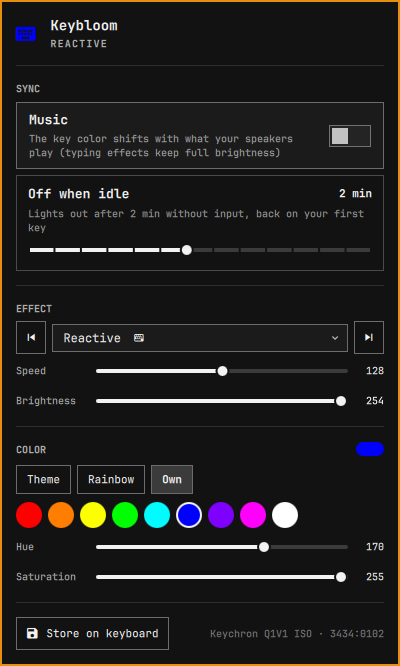
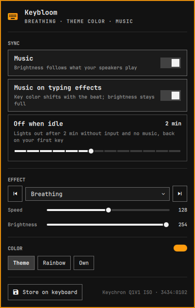

# Keybloom

An [Omarchy](https://omarchy.org) bar widget for the lighting of Keychron keyboards running QMK/VIA firmware.
Let the keyboard follow your Omarchy theme, run through the rainbow, or pick the effect, color, speed and brightness
yourself. The lights can pulse with your music, you can cycle effects with a key, and they go out while you are idle.

Every change stays in the keyboard's RAM. Keybloom writes the keyboard's flash memory only when you press
**Store on keyboard**, so playing with it does not wear the keyboard out.

| Your own color, Reactive effect | Theme color, Breathing, pulsing with music |
|---|---|
|  |  |

## Quick start

1. Install and enable the widget:

   ```
   omarchy plugin add https://github.com/schmittcn/omarchy-keybloom --enable
   ```

2. Give your user access to the keyboard: a one-time udev rule, switched on as root with the command under
   [Keyboard access](#keyboard-access) (best: for your keyboard only). Read that section first; it explains what
   the rule allows.

3. Plug the keyboard in with a USB cable (replug it if it was already in) and click the keyboard icon in the bar. The icon shows the keyboard's color
   (and runs through the rainbow with it); it is dimmed while the lights are off or the keyboard is unplugged.

On its first start, Keybloom takes over what the keyboard shows at that moment and changes nothing.

## Using it

| Section | What it does |
|---|---|
| **Sync · Music** | The lights follow what your speakers play, adjusting to the volume by themselves. Most effects pulse in brightness: loud is your full brightness, silence is dim. The typing effects (⌨) keep full brightness so your keypresses stay bright; there the key color shifts with the beat instead (Typing heatmap draws its own colors, so music shows nothing there). |
| **Sync · Music on typing effects** | Shown while Music is on. Turn it off and music leaves the typing effects alone: your keys light up in exactly the theme's (or your) color. |
| **Sync · Off when idle** | Turns the lights off after a time without input and back on with your first key. The slider has fixed steps: Never, 10, 15, 30, 45 s, 1, 2, 3, 5, 10, 15, 30, 45 min, 1 h (default 2 min). Idle inhibitors (e.g. a playing video) count, as they do for Omarchy's own idle. With Music on, the lights stay on while something plays. |
| **Effect** | Pick an effect from the list, or step through them with ◀ ▶ (or ← → in the open popup). The effects marked ⌨ react to typing; the keyboard does that by itself. |
| **Speed / Brightness** | The keyboard follows the slider while you drag. Speed also sets how fast Rainbow runs. |
| **Color · Theme** | The theme's keyboard color (`keyboard.rgb`), updated on every theme switch. Only the color changes; the effect stays yours. |
| **Color · Rainbow** | The color runs through all hues. Combine it with Solid color, Breathing or a Reactive effect; with effects that bring their own colors it pauses. |
| **Color · Own** | Quick picks, or hue and saturation (the keyboard follows while you drag). Picking a color switches to Own. |
| **Store on keyboard** | Writes the current settings to the keyboard's memory, so it shows them without Keybloom too (on another computer, or before the shell runs). It is greyed out while nothing has changed since the last store. |

You only need **Store on keyboard** if you want the keyboard to keep the look without Keybloom. While Keybloom runs, it
sends your settings again every time the keyboard is plugged in.

Every switch and slider takes effect at once; there is nothing to save.

### Where your settings live

Like every Omarchy widget's, Keybloom's settings are stored inline on its own entry in `~/.config/omarchy/shell.json`.
The popup writes them there when you change something (let go of a slider, flip a switch, step an effect), never while
you drag and never for a rainbow or music frame. In Theme mode the color is not stored at all (it comes from the
theme), so switching themes does not rewrite `shell.json`. A typical entry:

```json
{ "id": "io.github.schmittcn.keybloom", "effect": 20, "speed": 113, "brightness": 255, "colorMode": "rainbow",
  "hue": 25, "sat": 241, "music": true, "musicTyping": true, "idleSec": 120 }
```

You can also change them without the popup; the keyboard follows at once:

```
omarchy bar set io.github.schmittcn.keybloom effect 5
omarchy bar set io.github.schmittcn.keybloom music false
```

| Setting | Values |
|---|---|
| `effect` | the effect's number (0 is off) |
| `speed`, `brightness`, `hue`, `sat` | 0 to 255 |
| `colorMode` | `theme`, `rainbow` or `own` |
| `music`, `musicTyping` | `true` or `false` |
| `idleSec` | seconds until the lights go out when idle, 0 to 3600; 0 means never |
| `storedOnKeyboard` | written by **Store on keyboard**: what the keyboard's memory holds |
| `boards` | your own keyboards' effect lists, see [Adding your keyboard](#adding-your-keyboard) |

A value Keybloom cannot use is ignored (the current one stays and is written back). Disabling or removing the widget
drops its entry, and your settings with it, as for any Omarchy widget; the keyboard keeps its current look until it is
unplugged.

Only Solid color, Breathing, Band spiral and the Reactive effects are drawn in the chosen color. The others (the
cycles and rainbows, raindrops, heatmap, Splash) bring their own colors, and the popup says so when one of them is
selected.

If you change the lighting with the keyboard's own Fn keys, Keybloom takes that over the next time you open the popup.

### Keys

Cycle effects from anywhere by binding the widget's IPC calls, e.g. in `~/.config/hypr/bindings.conf`:

```
bindd = SUPER ALT, bracketright, Next keyboard effect, exec, omarchy-shell io.github.schmittcn.keybloom next
bindd = SUPER ALT, bracketleft, Previous keyboard effect, exec, omarchy-shell io.github.schmittcn.keybloom prev
```

`open`, `close` and `toggle` open and close the popup.

## Flash wear

A keyboard keeps its settings in flash memory, and flash survives only a limited number of writes. Keybloom keeps that
number at what you choose:

- Effect, color, speed, brightness, theme color, idle, Rainbow and Music use VIA's *set value* command (Rainbow and
  Music about 30 times a second while on). In QMK this calls the
  `*_noeeprom` functions: the keyboard changes the lighting in RAM and writes nothing.
- The only command that writes flash is VIA's *save* (`eeconfig_update_rgb_matrix()` in QMK). Keybloom sends it only
  when you press **Store on keyboard**, and not again until something has changed. It stores your still settings,
  not a rainbow or music frame.
- The keyboard's own Fn lighting keys do save to flash. That is how the stock firmware works, and Keybloom cannot change
  it.

## Keyboard access

Keybloom talks to the keyboard over its VIA raw-HID interface (`/dev/hidraw*`). By default only root can open those
devices, so your user needs a udev rule. Keybloom never installs it and never runs anything as root: switching it on and
off is up to you.

> **What the rule allows.** It lets *every program running as you* (not just Keybloom) open the keyboard's VIA
> interface. VIA can do more than lighting: it can also change keymaps and macros, so a malicious program running as
> you could plant a macro that types commands. The rule uses `TAG+="uaccess"`, which grants access only to the user
> logged in at the seat (not to other accounts, which `MODE="0666"` would), and only while that user is logged in.
> If that trade-off is not for you, switch the rule on while you set the lighting up, **Store on keyboard**, and
> switch it off again: the keyboard keeps the stored look without Keybloom.

**Switch on for your keyboard only** (recommended, as root). Replace `0102` at the end with your keyboard's product
id: Keybloom's popup shows it in the footer (`3434:0102` → `0102`), and so does `lsusb | grep 3434` (after `3434:`).

```
printf 'KERNEL=="hidraw*", SUBSYSTEM=="hidraw", ATTRS{idVendor}=="3434", ATTRS{idProduct}=="%s", TAG+="uaccess"\n' 0102 > /etc/udev/rules.d/70-keychron-via.rules && udevadm control --reload && udevadm trigger --subsystem-match=hidraw
```

Any other Keychron you plug in stays locked. If the popup then says the keyboard "may not be opened", the id does
not match: check it with `cat /etc/udev/rules.d/70-keychron-via.rules` against the footer.

**Switch on for every Keychron** (as root), e.g. if you use several:

```
echo 'KERNEL=="hidraw*", SUBSYSTEM=="hidraw", ATTRS{idVendor}=="3434", TAG+="uaccess"' > /etc/udev/rules.d/70-keychron-via.rules && udevadm control --reload && udevadm trigger --subsystem-match=hidraw
```

> **Both commands replace the whole file** (`>`): running one undoes the other, and running the second one after
> the first widens your rule again. To add a second keyboard to a narrow rule, append a line with its id instead:
> the same `printf` command with `>>` in place of `>`.

**Switch off** (as root), then **replug the keyboard**: access granted earlier stays on the open device until it
disappears.

```
rm -f /etc/udev/rules.d/70-keychron-via.rules && udevadm control --reload
```

**Check** (as you): is the rule there, and which Keychron interfaces can you open right now?

```
cat /etc/udev/rules.d/70-keychron-via.rules
for d in /sys/class/hidraw/*; do grep -qs 'HID_ID=0003:00003434' $d/device/uevent && echo "/dev/${d##*/}: $(getfacl -cp /dev/${d##*/} 2>/dev/null | grep "^user:$USER:" || echo 'no access')"; done
```

A line like `/dev/hidraw8: user:you:rw-` means access is on. With it off, Keybloom's popup says the keyboard "may not
be opened" and does nothing else.

Already have `70-keychron-via.rules` from [omakeychron](https://github.com/paulsp94/omakeychron)? That is the same
file and the same rule; the commands above switch it for both.

## Supported keyboards

Keychron keyboards with QMK/VIA firmware and an RGB matrix (per-key color): the Q, V, C Pro, K Pro, K Max and Q Max
lines. Tested on a wired **Q1 v1 ISO (3434:0102)**. Keyboards with white-only backlight are not supported.

- **Wired only.** The 2.4 GHz Link dongle and Bluetooth do not pass VIA commands through. What you stored with
  **Store on keyboard** stays when you go wireless.
- **Effect names.** Each model numbers its effects differently, depending on which ones its firmware includes. When
  the keyboard connects, Keybloom asks how many effects it has (it requests effect 255, which the firmware turns into
  its last one, reads that back and puts your effect back; RAM only). It then names them from `effects.json`, a table
  of 311 Keychron RGB keyboards (by USB product id) from upstream QMK and Keychron's own QMK fork: the Q, V, K, C,
  Pro, Max and HE lines, among others. The popup's footer shows which model it found.
- **Other models and firmware.** A keyboard that is not in the table, or whose firmware has a different number of
  effects than the table says (e.g. a newer firmware), shows its effects as "Effect 1", "Effect 2", …. Everything
  works, but Keybloom cannot tell which effects react to typing or use the color, so Music always pulses the
  brightness and the "brings its own colors" note never shows. You can add the names yourself; see below.

### When something is wrong

The popup says what it found, in a red box under the title:

| Message | What it means |
|---|---|
| No Keychron keyboard found | No Keychron with a VIA interface is plugged in. |
| … may not open it: add the udev rule | The keyboard is there, but your user has no access to it. See [Keyboard access](#keyboard-access). |
| … does not answer | Usually the 2.4 GHz Link dongle or Bluetooth: lighting control needs the USB cable. |
| Firmware is too old (VIA protocol N) | Firmware from before QMK 0.19 (late 2022) uses different lighting commands. Keybloom sends it nothing; update the firmware with Keychron Launcher. |
| No RGB lighting control over VIA | The firmware rejects RGB lighting commands: a white-backlight model, or RGB not built in. Keybloom sends it nothing. |
| Did not keep a test change | The effect set during the effect count check did not read back. Keybloom keeps going, but changes may not show. |
| Reported N effects, which looks wrong | The effect count check gave a nonsense number. Effects are numbered; some may be missing. |

### Adding your keyboard

The popup's footer shows your keyboard's product id and how many effects it has, e.g. `3434:0abc · 21 effects`.
Describe it in Keybloom's `boards` setting; entries there win over the shipped table:

```
omarchy bar set io.github.schmittcn.keybloom boards '{"0abc": {"model": "K9 Max ANSI RGB", "effects": ["solid_color", "breathing", "cycle_all", "solid_reactive_simple", "splash"]}}' --json
```

(or edit the `boards` field of Keybloom's entry in `~/.config/omarchy/shell.json` by hand). Several keyboards go into
the same object, one product id each.

- `effects` lists the effects 1, 2, 3, … in the order the keyboard numbers them (effect 0, off, is not listed), and
  must have exactly as many entries as the footer says. Otherwise Keybloom ignores the entry and says why in the popup.
- Use QMK's effect names (`solid_color`, `cycle_all`, `solid_reactive_simple`, … as in the keyboard's `info.json`
  under `rgb_matrix.animations`): then the list shows them nicely named, and Keybloom knows which ones react to typing
  and which use the chosen color. Any other text (e.g. `"Fireworks"` for an effect of custom firmware) is shown as
  written.
- To find the list: cycle through the effects with the keyboard's Fn keys or Keybloom's ◀ ▶ and write down what each
  one does, or run `tools/gen_effects.py` on the QMK tree the firmware was built from and copy that board's entry.
- The names change as soon as the setting does; no replug needed.
- Works for you? Open an issue or pull request with the entry, so it ships for everyone.

## Security and privacy

- Keybloom never reads your keystrokes. The effects that react to typing run inside the keyboard.
- With Music on, `pw-record` captures what your speakers play (8 kHz mono). Keybloom only computes the loudness of each
  few milliseconds in memory; no audio is stored or sent anywhere. With Music off, nothing is captured. The capture
  shows up in your audio mixer like any recording app.
- No network access, no root, nothing installed outside the plugin folder. The udev rule is a step you do yourself.
- It reads `~/.local/state/omarchy/current/theme/keyboard.rgb` (size-limited, no symlinks) and the hidraw entries in
  `/sys/class/hidraw/`. It writes no files of its own: your settings go into Keybloom's entry in
  `~/.config/omarchy/shell.json` through the shell's plugin API, which lets a plugin change only its own entry. Every
  setting read back from there is checked; a malformed one is ignored.
- It sends the keyboard only lighting commands: get, set and save on the RGB matrix channel. Keymaps and macros are
  never touched.
- The udev rule lets every program running as you talk to the keyboard, including VIA's keymap and macro commands
  (see [Keyboard access](#keyboard-access)). That is a property of the rule and of VIA, not of Keybloom: switch it on
  for your keyboard only, or only while you need it.

## What you need

| Tool | Used for | Without it |
|---|---|---|
| `python3` | the helper `keybloom.py` (standard library only) | the widget shows "keybloom.py stopped" |
| udev rule ([Keyboard access](#keyboard-access)) | access to the keyboard | the popup says the keyboard may not be opened |
| `pw-record` (PipeWire, part of Omarchy) | Music | Music shows an error; everything else works |

## Removing

```
omarchy plugin remove io.github.schmittcn.keybloom
```

Your settings go with the widget's entry in `shell.json`. What stays behind:

- The udev rule, if no other tool needs it: see **Switch off** under [Keyboard access](#keyboard-access).
- The look last stored on the keyboard. Change it with the Fn keys or [VIA](https://usevia.app).

## How it works

`Panel.qml` is the bar icon and popup. It starts `keybloom.py serve`, which runs for as long as the widget is loaded.
The popup hands it your settings from `shell.json` first (and again whenever the entry changes); the helper touches
the keyboard only after that, reports the settings back whenever they change, and the popup writes them to the entry.
The helper holds the keyboard open, notices at once when the keyboard is unplugged (or the computer
suspends), looks for it every 2 s until it is back, sends your settings again, and answers each command from the popup
with its status as one JSON line. On connecting it checks the firmware first (VIA protocol 11 or newer, RGB matrix
commands answered) and sends nothing to a keyboard that fails; see [When something is wrong](#when-something-is-wrong). Theme switches arrive through the shell's accent color,
idle through Quickshell's `IdleMonitor`.

## Development

The shell loads plugins only from real folders under `~/.config/omarchy/plugins/` (a symlink is skipped). Work in
this folder and copy it over after each change; the shell reloads by itself:

```
rsync -a --delete --exclude screenshots --exclude __pycache__ ./ ~/.config/omarchy/plugins/io.github.schmittcn.keybloom/
```

Test the helper's logic (no keyboard needed): `python3 -I test_keybloom.py`. Check the manifest:
`omarchy plugin validate .`

Rebuild `effects.json` from current QMK and Keychron trees (instructions at the top of `tools/gen_effects.py`).
Boards whose files do not parse are left out with a warning (at the time of writing: the S1 ANSI RGB upstream, and
the K3 Max and K5 Max on Keychron's `wireless_playground` branch, which `2025q3` covers).

`preview.png` and `screenshots/` are cut from real screenshots of the popup and placed on a plain background.

## Credits

The keyboard discovery, the `keyboard.rgb` reader and the LED color correction in `keybloom.py` come from
[omakeychron](https://github.com/paulsp94/omakeychron) by paulsp94, also under the MIT license. Its copyright line is
in [LICENSE](LICENSE), and the code is marked in `keybloom.py`.

## License

[MIT](LICENSE).
